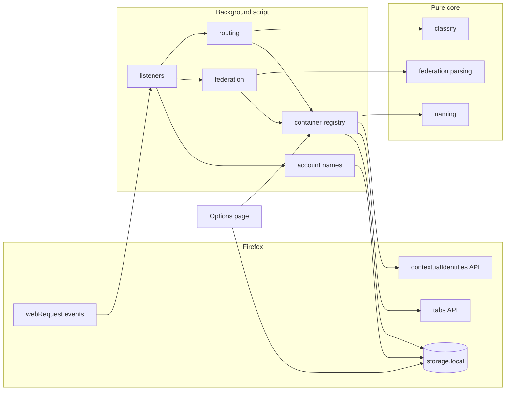
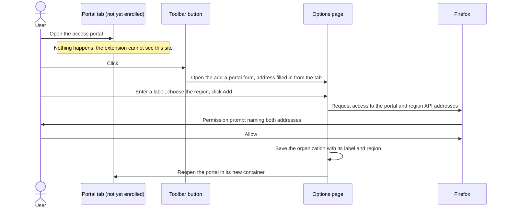
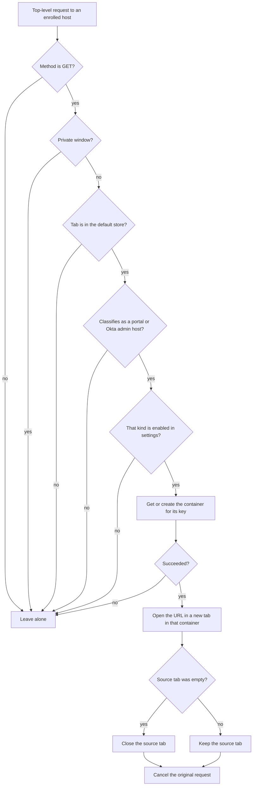
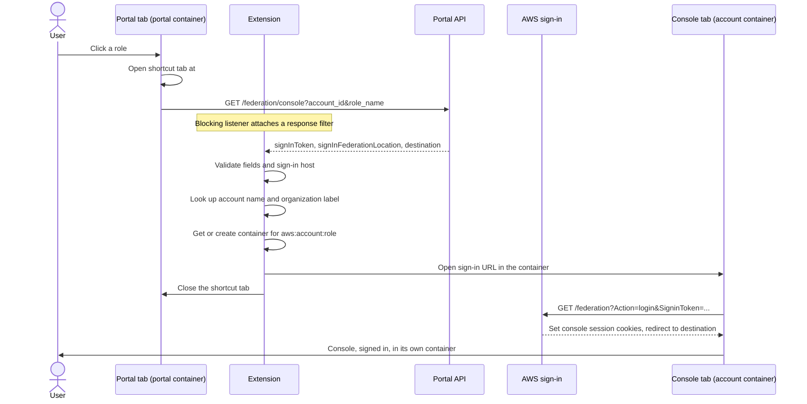
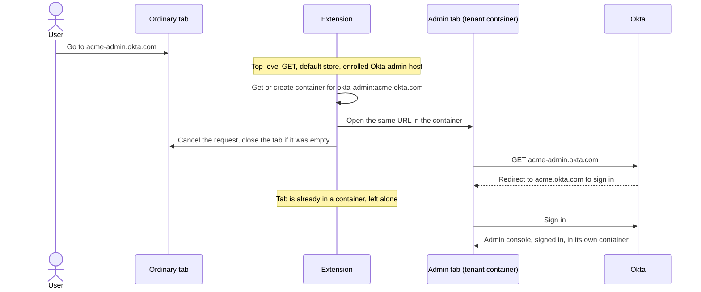
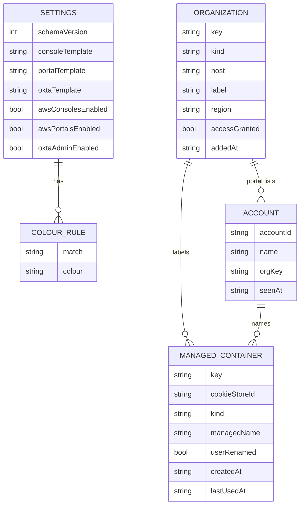

<!-- markdownlint-disable-file MD013 MD025 MD041 -->

# DESIGN-0001: Automatic AWS and Okta admin containers extension

<!--toc:start-->
<!-- markdownlint-capture -->
<!-- markdownlint-disable MD013 -->
- [Overview](#overview)
- [Goals and Non-Goals](#goals-and-non-goals)
  - [Goals](#goals)
  - [Non-Goals](#non-goals)
- [Background](#background)
  - [What the spike established](#what-the-spike-established)
  - [What the spike got wrong or left rough](#what-the-spike-got-wrong-or-left-rough)
  - [Terms](#terms)
- [Detailed Design](#detailed-design)
  - [Architecture](#architecture)
  - [Targets and keys](#targets-and-keys)
  - [Enrolment](#enrolment)
  - [Routing navigations](#routing-navigations)
  - [AWS console hand-off](#aws-console-hand-off)
  - [Account names](#account-names)
  - [Okta admin consoles](#okta-admin-consoles)
  - [Container registry](#container-registry)
  - [Naming, labels and colours](#naming-labels-and-colours)
  - [Options page](#options-page)
  - [Background script lifecycle](#background-script-lifecycle)
  - [Manifest and permissions](#manifest-and-permissions)
  - [Security](#security)
  - [Failure handling](#failure-handling)
  - [Source layout](#source-layout)
- [API / Interface Changes](#api--interface-changes)
- [Data Model](#data-model)
- [Testing Strategy](#testing-strategy)
- [Migration / Rollout Plan](#migration--rollout-plan)
- [Open Questions](#open-questions)
  - [1. How much of AWS should the extension be allowed to see?](#1-how-much-of-aws-should-the-extension-be-allowed-to-see)
  - [2. TypeScript with a bundler, or plain JavaScript with no build?](#2-typescript-with-a-bundler-or-plain-javascript-with-no-build)
  - [3. Where should account names be kept?](#3-where-should-account-names-be-kept)
  - [4. What happens when you rename a managed container in Firefox's own UI?](#4-what-happens-when-you-rename-a-managed-container-in-firefoxs-own-ui)
  - [5. Clicking a role when its console is already open](#5-clicking-a-role-when-its-console-is-already-open)
  - [6. Default colour rules](#6-default-colour-rules)
  - [7. Should settings sync between Firefox profiles?](#7-should-settings-sync-between-firefox-profiles)
  - [8. How should a failed hand-off be reported?](#8-how-should-a-failed-hand-off-be-reported)
  - [9. Which partitions and base domains in the first version?](#9-which-partitions-and-base-domains-in-the-first-version)
  - [10. Toolbar button behaviour](#10-toolbar-button-behaviour)
  - [11. Automated end-to-end tests](#11-automated-end-to-end-tests)
  - [12. Cleaning up unused containers](#12-cleaning-up-unused-containers)
  - [13. Should Okta tenants be enrolled the same way as AWS portals?](#13-should-okta-tenants-be-enrolled-the-same-way-as-aws-portals)
  - [14. How does the extension learn a portal's region?](#14-how-does-the-extension-learn-a-portals-region)
- [References](#references)
<!-- markdownlint-restore -->
<!--toc:end-->

<!--docz:overview:start-->
## Overview

A Firefox extension that keeps AWS and Okta admin sessions apart by opening
each one in its own automatically created container. AWS consoles get a
container per account and permission set, AWS access portals get a container
per portal, and Okta admin consoles get a container per tenant. Containers
are created on first use, reused afterwards, and named with labels the user
can edit.

No site access is granted at install. The user enrols each portal and each
Okta tenant once, which grants access to that organization's addresses
only.

The approach was investigated in INV-0001 and proven against a real access
portal and real Okta tenants in the IMPL-0001 spike. This document designs
the real extension that replaces the spike.

<!--docz:overview:end-->

## Goals and Non-Goals

<!--docz:goals:start-->
### Goals

- Open an AWS console session in a container for its account and permission
  set, whether it starts from a click in the access portal or a shortcut
  link.
- Open each AWS access portal in its own container, so portals backed by
  different identity providers stay signed in side by side.
- Open each Okta tenant's admin console in its own container, so several
  tenants stay signed in at once.
- Create containers on first use and reuse them afterwards, without
  duplicates when a name or label changes.
- Grant no access to any site until the user has enrolled that portal or
  tenant.
- Give every portal and tenant an editable label, and let the user control
  how containers are named and coloured.
- Stay small enough to audit: no code from other extensions, no runtime
  dependencies, no network requests of its own, and the narrowest
  permissions that work.
- Fail safe: when anything is unexpected, leave the page to do what it would
  have done without the extension.

<!--docz:goals:end-->

<!--docz:non-goals:start-->
### Non-Goals

- Routing Okta end-user dashboards (`<org>.okta.com`) or the apps launched
  from them. To run an app against a specific tenant, open it in that
  tenant's container by hand.
- Moving a tab that is already in a container. A portal launched from inside
  an Okta admin container stays there.
- Browsers other than desktop Firefox.
- AWS sign-in paths that do not go through an IAM Identity Center access
  portal: the legacy SAML role picker, IAM user sign-in, root sign-in.
- Detecting a live console session and focusing its tab instead of signing
  in again. Each role click opens a fresh tab in the same container
  (decided in open question 5).
- A protocol handler for CLI tools such as `granted` or `aws-sso-cli`.
- Okta custom domains. Admin consoles are served from `<org>-admin` on an
  Okta base domain even when the tenant has a custom sign-in domain.

<!--docz:non-goals:end-->

<!--docz:background:start-->
## Background

### What the spike established

IMPL-0001 ran a throwaway extension (`spike/`) on Firefox 159 against a real
portal and two real Okta tenants. The facts this design relies on:

| Fact | Detail |
| ---- | ------ |
| Containers need no other add-on | The `contextualIdentities` permission alone enables them in a fresh profile. Opening a tab in one also needs `cookies`. |
| Portal page host | `<directory-id>.awsapps.com/start/` |
| Portal API host | `portal.sso.<region>.amazonaws.com` |
| Console sign-in request | `GET /federation/console?account_id=…&role_name=…`, returning JSON with `signInToken`, `signInFederationLocation`, `destination` |
| Sign-in location | `https://<region>.signin.aws.amazon.com/federation` |
| Account names | `POST /instance/appinstances`, in `result[].searchMetadata.AccountName`, keyed by `AccountId` |
| Reading a response body | Needs `webRequest`, `webRequestBlocking` and `webRequestFilterResponse` under Manifest V3 |
| Background script lifetime | Stopped when idle and woken by events. Interception still worked after a wake-up. An open DevTools toolbox keeps it awake. |
| Okta admin hosts | `<org>-admin.okta.com` and `<org>-admin.oktapreview.com`; sign-in completes inside the container |

### What the spike got wrong or left rough

These are the things the real design has to fix:

- **Lookup by name creates duplicates.** Changing the name format left the
  old containers behind and created new ones.
- **The default organization label is a directory ID** (`d-1234567890`),
  which is not readable.
- **Account names lived in session storage**, so after a browser restart a
  shortcut link could be handled before any name was known.
- **Host permissions were broad and granted up front.** The spike asked for
  all of `*.amazonaws.com` and every portal address at install.
- **The sign-in location was trusted as given.** The spike opened whatever
  URL the response named.

### Terms

| Term | Meaning |
| ---- | ------- |
| Container | A Firefox contextual identity: a named, coloured, separate cookie store. Identified by a `cookieStoreId`. |
| Default store | A tab that is in no container (`firefox-default`). |
| Access portal | The IAM Identity Center page listing accounts and permission sets. |
| Shortcut tab | The tab the portal opens at `…/#/console?account_id=…&role_name=…` when a role is clicked. Bookmarked shortcut links open the same page. |
| Organization | One access portal or one Okta tenant. Carries an editable label. |
| Managed container | A container this extension created and tracks. |

<!--docz:background:end-->

<!--docz:detailed-design:start-->
## Detailed Design

### Architecture

Everything runs in one non-persistent background script, plus an options
page. There are no content scripts: the extension never runs code inside a
web page and never reads a page's DOM.



The code is split so that every decision is made by a pure function that
takes plain data and returns plain data. Only a thin layer touches browser
APIs. This is what makes the logic testable without a browser.

| Module | Kind | Responsibility |
| ------ | ---- | -------------- |
| `core/classify` | pure | URL to target: which kind of thing is this, and what is its key? |
| `core/routing` | pure | Request facts to a decision: move, or leave alone, and why. |
| `core/federation` | pure | Parse and validate the federation response; build the sign-in URL. |
| `core/naming` | pure | Templates, labels and colour rules to a container name, colour and icon. |
| `background/registry` | browser | Get, create, rename and forget managed containers. |
| `background/accounts` | browser | Learn account names from the portal's account list. |
| `background/listeners` | browser | Register listeners; translate events to core calls and results to API calls. |
| `storage` | browser | Typed read and write of settings and state, with schema migration. |
| `options` | browser | Settings page. |

### Targets and keys

A target is something that gets its own container. Each has a stable key.
The key, not the name, identifies the container.

| Kind | Key | Example |
| ---- | --- | ------- |
| AWS console | `aws:<account-id>:<permission-set>` | `aws:111122223333:AdminAccess` |
| AWS access portal | `aws-portal:<portal-host>` | `aws-portal:d-1234567890.awsapps.com` |
| Okta admin console | `okta-admin:<tenant-host>` | `okta-admin:acme.okta.com` |

AWS account IDs are globally unique, so the console key does not include
the portal. The portal contributes only the organization label used in the
name.

Classification rules:

- **Portal:** the host is an enrolled portal and the path starts with
  `/start`. A portal that has not been enrolled is invisible to the
  extension. The newer `<id>.portal.<region>.app.aws` and
  `<tenant>.account-access.<region>.app.aws` forms are recognised too, but
  are untested.
- **Okta admin:** the host is an enrolled tenant's admin address: exactly
  one label ending in `-admin` under an Okta base domain. The tenant host is the same host with `-admin` removed.
  `<org>.okta.com` itself never matches.
- **AWS console:** not classified from a navigation. It is identified from
  the federation request's `account_id` and `role_name` parameters.

### Enrolment

The extension is granted no site access when it is installed. An AWS portal
or an Okta tenant is handled only after the user has enrolled it. Enrolling
grants access to exactly the addresses below and names the organization in
the same step.

| Enrolling | Grants | Example | Used for |
| --------- | ------ | ------- | -------- |
| An AWS portal | The portal's own address | `https://d-1234567890.awsapps.com/*` | Routing the portal into its container; seeing the portal page's requests |
| An AWS portal | The API address for its region | `https://portal.sso.us-west-2.amazonaws.com/*` | Reading the sign-in and account-list responses |
| An Okta tenant | The tenant's admin address | `https://acme-admin.okta.com/*` | Routing the admin console into its container |

The diagram shows a portal. An Okta tenant is the same without the region.



Details:

- **Starting point.** Clicking the toolbar button on a page gives the
  extension that tab's address once, through the `activeTab` permission.
  If the address is a portal or an Okta admin console that is not
  enrolled, the options page opens on the add form with the address
  filled in. Either can also be added by typing its address into the
  form.
- **The label is required.** For a portal this replaces the directory ID as
  the organization name everywhere, so a console container is named, for
  example, `payments-prod(prod-org) / AdminAccess` from the first click.
- **The request must come straight from the click.** Firefox only shows a
  permission prompt from a user action in an extension page, and rejects
  the request if anything is awaited first. The Add button's handler
  calls `permissions.request` before doing anything else.
- **Declared, not granted.** The manifest lists `https://*.awsapps.com/*`,
  the region API addresses and the Okta base domains under
  `optional_host_permissions`. That makes them requestable; it grants
  nothing. The extension then asks for the one specific portal or admin
  address. Requesting a single address covered by
  a declared wildcard is expected to work in Firefox but has not been
  tested; it is the first thing checked in rollout step 1. If it does not
  work, enrolment grants the whole of `awsapps.com`, or the tenant's Okta
  base domain, instead.
- **Removing a portal** revokes both addresses, unless another enrolled
  portal shares the region. **Removing a tenant** revokes its admin
  address.
- **Access revoked in Firefox.** A user can remove a grant in the add-on
  manager. The extension listens for that and marks the portal as needing
  access again, instead of failing silently.
- **Region.** Chosen from a list when a portal is added. If a shortcut tab opens in an enrolled portal's
  container and no sign-in request is seen, the toolbar badge warns that
  the portal's region may be wrong, and the options page lets it be
  changed.

### Routing navigations

Portals and Okta admin consoles are routed by a blocking
`webRequest.onBeforeRequest` listener on top-level navigations.



Points that follow from this:

- **A tab cannot change container.** Firefox fixes a tab's cookie store when
  the tab is created, so "moving" always means opening a new tab and
  cancelling the request in the old one. If the old tab had a page in it,
  it stays on that page.
- **No loops.** The new tab is in a container, so its request is left alone.
- **Redirects are covered.** `onBeforeRequest` fires for each hop of a
  redirect chain, so a redirect that ends at a portal is routed too.
- **POSTs are never moved.** The body cannot be replayed from a URL. This is
  also what keeps identity-provider sign-in responses in the tab they belong
  to.
- **Sign-in inside the container.** After a portal or admin console is
  moved, its redirect to the identity provider happens in a tab that is
  already in a container, so it is left alone and the session is
  established there.

### AWS console hand-off

The portal page asks its API for a sign-in token and then navigates to the
console with it. The extension reads that response, keeps it from the page,
and opens the sign-in URL in the account's container instead.



Steps in detail:

1. **Match.** The listener matches `GET /federation/console` on a portal API
   host with both `account_id` and `role_name` present. OPTIONS preflights
   and anything else are ignored.
2. **Filter.** `webRequest.filterResponseData` is attached synchronously
   inside the listener. The body is buffered and not passed on yet.
3. **Validate.** The body must be JSON with a non-empty `signInToken` and a
   `signInFederationLocation` that is an `https:` URL on an AWS sign-in host
   (see [Security](#security)). `account_id` must be twelve digits and
   `role_name` must match the IAM role-name character set.
4. **Build the sign-in URL.**
   `<signInFederationLocation>?Action=login&SigninToken=<token>&Issuer=<portal page URL>&Destination=<destination>`,
   with every value URL-encoded. The destination is taken from the shortcut
   link if it carries one, otherwise from the response, otherwise the
   console home page.
5. **Open.** Get or create the container for the key and open the sign-in
   URL in a new tab beside the requesting tab.
6. **Close the shortcut tab.** Only if the requesting tab's URL is a
   shortcut page (`#/console`). Any other tab, such as the portal itself,
   is left open.
7. **On any failure, release.** If validation fails, the container cannot be
   created, or the tab cannot be opened, the buffered body is written back
   to the page unchanged and the page signs in as it would without the
   extension. A warning badge is shown on the toolbar button, with the
   reason in its tooltip and on the options page.

The token is used once, in the URL of the tab the extension opens. It is
never logged and never stored.

### Account names

A second blocking listener watches `POST /instance/appinstances` on the
portal API host. Its response filter passes every chunk through to the page
immediately and keeps a copy. When the response ends, account IDs and names
are extracted and saved.

- Names are saved with the portal they were seen on and the time.
- If a console container already exists under an account ID because the
  name was not yet known, it is renamed in place when the name arrives.
- If the name is unknown when a console is opened, the account ID is used
  in its place.

### Okta admin consoles

Okta needs no response reading at all. It is the routing rule applied to
the admin hosts of enrolled tenants.



### Container registry

The registry is the only code that creates, renames or forgets containers.
It maps a target key to a container.

**Get or create**, given a key and the desired name, colour and icon:

1. Look the key up in the stored map.
2. If found, ask Firefox for that `cookieStoreId`. If it still exists, use
   it. If the desired name differs from the name the extension last gave
   it, and the user has not renamed it by hand, rename it.
3. If the map has no entry, or the container no longer exists, create one
   and store the mapping.

Rules:

- **One creation at a time per key.** Two role clicks in quick succession
  must not create two containers. Requests for the same key share one
  in-flight promise.
- **Hand renames are respected.** The registry records the name it last
  set. If the container's current name differs, the user changed it in
  Firefox, and the registry stops renaming that container. The
  options page shows it as renamed by hand, with a button to hand naming
  back.
- **Removal is noticed.** `contextualIdentities.onRemoved` deletes the map
  entry, so the next use creates a fresh container.
- **Label and template edits rename in place.** Saving the options page
  recomputes the name of every managed container and renames those that
  changed.
- **Existing containers are never adopted.** A container the extension did
  not create is never renamed or removed, even if its name matches.

### Naming, labels and colours

Names come from templates with a fixed set of tokens.

| Kind | Default template | Example |
| ---- | ---------------- | ------- |
| AWS console | `{account}({org}) / {role}` | `payments-prod(acme) / AdminAccess` |
| AWS access portal | `{org} portal` | `acme portal` |
| Okta admin console | `{org} okta admin` | `acme okta admin` |

| Token | Value |
| ----- | ----- |
| `{account}` | Account name, or the account ID if the name is not known |
| `{accountId}` | Twelve-digit account ID |
| `{role}` | Permission set name |
| `{org}` | The organization's label |

**Organization labels.** Every portal and Okta tenant has a label.

- An Okta tenant's label is chosen when the tenant is enrolled. The form
  suggests the org name, with "(preview)" or "(emea)" appended for the
  other base domains.
- A portal's label is chosen when the portal is enrolled, so there is no
  unreadable default.
- Labels are edited in the options page. Saving renames the affected
  containers.

**Colours and icons.** Firefox offers eight colours and a fixed icon set.

- An ordered list of rules maps a case-insensitive substring of the final
  name to a colour. The first match wins.
- Three rules ship by default and can be edited: names containing `prod`
  are red; `stag` or `stage` yellow; `dev`, `test` or `sandbox` green.
- With no matching rule, the colour is a stable hash of the key, so a
  container keeps its colour.
- Icons are fixed per kind: one for consoles, one for portals, one for Okta
  admin.

### Options page

A single page, opened from the add-on manager or the toolbar button.

| Section | Contents |
| ------- | -------- |
| Organizations | Enrolled portals and Okta tenants, each with its address, region where relevant, access status and an editable label. Add and remove buttons. |
| Naming | The three name templates, with a live preview. |
| Colours | The ordered rule list. |
| Behaviour | Three switches: AWS consoles, AWS access portals, Okta admin consoles. |
| Managed containers | Every managed container with its key, name and last use. A button removes those with no open tabs. |
| Backup | Export settings to a file and import them back. |

### Background script lifecycle

The background script is stopped when idle and started again by the next
event, so it must hold no state in memory that it cannot rebuild.

- All listeners are registered synchronously at the top level of the
  script, on every start.
- Settings and state are read from storage when an event needs them, behind
  a single cached promise. A listener awaits that promise before deciding.
- The routing listener returns a promise; Firefox holds the request until
  it resolves.
- The federation listener attaches its response filter synchronously, then
  awaits settings inside the filter's completion handler, where the request
  is already being held.
- The only in-memory state is the per-key creation lock, which is safe to
  lose.
- When access to an address is granted (`permissions.onAdded`), the request
  listeners are removed and registered again. Firefox may already deliver
  events for a newly granted address to a listener registered earlier;
  registering again makes the extension correct either way.

### Manifest and permissions

```json
{
  "manifest_version": 3,
  "browser_specific_settings": {
    "gecko": {
      "id": "ff-aws-okta-containers@donaldgifford",
      "strict_min_version": "140.0",
      "data_collection_permissions": { "required": ["none"] }
    }
  },
  "permissions": [
    "contextualIdentities",
    "cookies",
    "tabs",
    "activeTab",
    "storage",
    "webRequest",
    "webRequestBlocking",
    "webRequestFilterResponse"
  ],
  "optional_host_permissions": [
    "https://*.awsapps.com/*",
    "https://*.app.aws/*",
    "https://portal.sso.<region>.amazonaws.com/*",
    "https://*.okta.com/*",
    "https://*.oktapreview.com/*",
    "https://*.okta-emea.com/*"
  ],
  "background": { "scripts": ["background.js"] },
  "options_ui": { "page": "options.html", "open_in_tab": true },
  "action": { "default_title": "AWS and Okta containers" }
}
```

Why each permission is needed:

| Permission | Why |
| ---------- | --- |
| `contextualIdentities` | Create, rename and remove containers. |
| `cookies` | Firefox requires it to open a tab with a `cookieStoreId`. The cookies API itself is never called. |
| `tabs` | Read a tab's URL and container to decide routing and to close shortcut tabs. |
| `activeTab` | Read the current tab's address when the toolbar button is clicked, to offer enrolment. |
| `storage` | Settings and the container map. |
| `webRequest`, `webRequestBlocking` | Cancel and reopen navigations; hold the federation response. |
| `webRequestFilterResponse` | Read the federation and account-list response bodies. |

Host permissions:

- **None are granted at install.** There is no `host_permissions` entry.
- **The optional list declares what may be requested:** portal addresses,
  one API address per AWS region, and the Okta base domains. The region
  entries are written into the checked-in manifest by a script from a
  region list, with CI confirming the two agree.
- **Grants are per portal and per tenant,** made through
  [Enrolment](#enrolment).

### Security

The extension sits in the sign-in path for production accounts. These are
the properties the design guarantees, and how each is enforced.

| Property | How it is enforced |
| -------- | ------------------ |
| Makes no network requests of its own | No `fetch`, `XMLHttpRequest`, `WebSocket` or `sendBeacon` in the source. A CI check fails if the extension source contains them. |
| Never reads or writes cookies | The `cookies` permission is held only for `cookieStoreId`. A CI check fails if the extension source references `browser.cookies`. |
| Runs no code in web pages | No content scripts, no `scripting` permission. |
| Loads no remote code | No remote scripts, no `eval`, default extension content security policy. |
| Never logs or stores a token | The sign-in token exists only in a local variable and the opened tab's URL. Logging helpers accept field names, never response values. |
| Opens only AWS sign-in URLs | `signInFederationLocation` must be `https:` on `signin.aws.amazon.com` or a region subdomain of it. Anything else is released to the page untouched. |
| Never widens where a session lands | A failure releases the response to the page, so the session ends up where it would have without the extension. It is never sent to a different, wrong container. |
| Ships no third-party runtime code | Zero runtime dependencies. There is no `package.json`. Development tools (type checking, linting, `web-ext`) are pinned in `mise.toml` and updated through Renovate. |
| Touches no site the user has not enrolled | No host access is granted at install. Each portal's two addresses, and each Okta tenant's admin address, are granted through a Firefox prompt that names them. |
| Stores no secrets | Storage holds labels, templates, rules, the container map and account names. |

What the extension does hold that is worth protecting: account names,
account IDs, permission-set names and organization labels, in local
extension storage. These describe the user's environment. They never leave
the browser unless the user exports settings.

Residual risks:

- **Portal API changes.** The federation and account-list endpoints are
  undocumented. If they change, the extension stops moving consoles; it
  does not misroute them. The fields it depends on are few and are checked
  on every response.
- **Sign-in URL in tab history.** The container tab's history holds the
  sign-in URL with its single-use token, exactly as it would without the
  extension.
- **New AWS regions.** A region missing from the checked-in list cannot be
  chosen at enrolment until a release adds it.

### Failure handling

| Situation | Behaviour |
| --------- | --------- |
| Federation response is not JSON, or lacks the expected fields | Release it to the page unchanged. |
| Sign-in location is not an AWS sign-in host | Release it to the page unchanged. |
| Container cannot be created or the tab cannot be opened | Release, or for routing, let the original request proceed. |
| Mapped container was deleted by the user | Create a new one and update the map. |
| Account name not known yet | Name the container with the account ID; rename when the name arrives. |
| Portal or tenant not enrolled | Do nothing. The extension cannot see it. The toolbar button offers to add it. |
| Access to an enrolled portal or tenant was revoked in Firefox | Stop handling it and mark it as needing access in the options page. |
| Private window | Do nothing. Containers do not exist there. |
| Storage is unreadable or from a newer version | Do nothing: route and intercept nothing, and show an error on the toolbar button. |
| A kind is switched off in settings | That kind's requests are left alone. |

### Source layout

```text
extension/
  manifest.json           checked in; host permissions written by a script
  src/
    core/                 pure logic, no browser APIs
      classify.js
      routing.js
      federation.js
      naming.js
    background/
      index.js            listener registration
      registry.js
      accounts.js
    storage/
      schema.js           types and migrations
      store.js
    options/
      options.html
      options.js
  regions.json            AWS regions for portal API host permissions
  test/
    core/                 unit tests with sanitized fixtures
    smoke/                headless Firefox load test
```

Plain JavaScript modules with JSDoc types, checked by `tsc` and packaged
and linted with `web-ext`. There is no bundler, so the files in the
repository are the files that run. `spike/` is deleted when the first
version of `extension/` handles all three kinds.

<!--docz:detailed-design:end-->

<!--docz:api-changes:start-->
## API / Interface Changes

There is no existing extension, so everything here is new. The interfaces a
user or another tool can depend on:

- **Container names** follow the templates above. They are for people to
  read; nothing should parse them.
- **Settings export** is a JSON file in the settings schema below, with a
  `schemaVersion` field. Import accepts the current version and older ones.
- **Toolbar button** opens the options page and shows a warning badge after
  a failed hand-off. There is no popup.
- **`just` recipes** gain `test`, `typecheck`, `ext-lint`, `ext-run` and
  `package`, replacing the `spike-*` recipes. There is no build step.
- **CI** gains unit tests, type checking, the source checks from the
  security section, and `web-ext lint`.

<!--docz:api-changes:end-->

<!--docz:data-model:start-->
## Data Model

All data is in `storage.local`. Nothing is kept in `storage.sync`.



| Record | Key | Notes |
| ------ | --- | ----- |
| Settings | single record | Templates, switches and colour rules. The only part included in an export, along with organization labels. |
| Organization | `aws-portal:<host>` or `okta-admin:<host>` | Created when a portal or tenant is enrolled, with its label, and for a portal its region. `accessGranted` tracks whether Firefox still grants its addresses. |
| Account | account ID | Learned from the portal's account list. |
| Managed container | target key | `managedName` is the name the extension last set; comparing it with the live name detects a hand rename. |

Schema changes are handled by numbered migrations run when storage is first
read. Data written by a newer version than the running code is not touched,
and the extension disables itself as described under failure handling.

`cookieStoreId` values are local to one Firefox profile, so the container
map is never exported or synced.

<!--docz:data-model:end-->

<!--docz:testing:start-->
## Testing Strategy

| Layer | What it covers | How |
| ----- | -------------- | --- |
| Unit | Classification, routing decisions, federation parsing and validation, sign-in URL building, naming, colour rules, schema migrations | Node's built-in test runner against the pure core, with sanitized fixtures. Runs in CI. |
| Registry | Get-or-create, rename, hand-rename detection, removal, the per-key lock | Node's built-in test runner with a small in-memory fake of the `contextualIdentities` and `storage` APIs. Runs in CI. |
| Source checks | No network calls, no cookies API, no `eval`; JSDoc types hold | A script over the extension source, and `tsc` in check-only mode. Runs in CI. |
| Smoke | The extension loads in headless Firefox with no errors, and creates then reuses a container | `web-ext run` headless, as the spike did. Run locally, not in CI. |
| Manual | The real flows against a real portal and real Okta tenants | A checklist in the repository, run before each release. |

Cases the unit tests must include, each taken from something the spike or
its predecessors got wrong:

- The account list arriving as a POST.
- A federation response with a missing field, extra fields, a non-JSON
  body, and an empty body.
- A sign-in location on a host that is not AWS.
- `<org>.okta.com` not matching, and `-admin.okta.com` with no org name not
  matching.
- A navigation from a tab already in a container, a POST, and a private
  window all being left alone.
- A name template change renaming a container instead of creating one.
- A container renamed by hand not being renamed back.

Enrolment adds cases too: an unenrolled portal or tenant being ignored, a
revoked grant being noticed, and removing one of two portals that share a
region.

Manual checklist additions the spike did not cover: a bookmarked shortcut
link, and a portal launched from an Okta dashboard tile in an ordinary tab.

Fixtures contain placeholder identifiers only. The repository is public.

Automated end-to-end tests against a fake portal are not planned for the
first version.

<!--docz:testing:end-->

<!--docz:rollout:start-->
## Migration / Rollout Plan

There are no existing users. The only migration is from the spike on the
author's own machine: containers the spike created are not adopted, so they
are deleted by hand once.

| Step | Delivers | Exit condition |
| ---- | -------- | -------------- |
| 1. Skeleton | `extension/` with lint, type-check, unit-test and smoke-test wiring in CI. Confirm by hand that Firefox grants a single portal or admin address requested under a declared wildcard. | CI green on an extension that does nothing; the permission behaviour is recorded |
| 2. Core and registry | Pure core and container registry, fully unit tested | All unit tests listed above pass |
| 3. AWS consoles | Enrolment, federation hand-off and account names | Manual checklist passes for consoles |
| 4. Portals and Okta | Navigation routing for both | Manual checklist passes for all three kinds; `spike/` deleted |
| 5. Options page | Labels, templates, colours, switches, managed-container list, export and import | Editing a label renames containers in place |
| 6. Daily-use build | Manual checklist, README, icon, `just package`; version `0.1.0` tagged | Loaded by hand from a checkout, the extension passes the checklist in full |
| Deferred: signing | Unlisted signing in the release workflow, signed `.xpi` attached to the GitHub release | Taken up after a period of daily use; see IMPL-0002 |
| Deferred: listing | Public listing in the Mozilla add-ons directory | Decided after signing |

Each step is one or more pull requests. Steps 1 to 5 release nothing
(`dont-release`). Step 6 is the first version. Until signing is done, the
extension is loaded from `about:debugging` and has to be loaded again
after each Firefox restart.

Rollback at any point is uninstalling the extension. Containers it created
remain, with their sessions, and can be removed in Firefox's container
settings.

<!--docz:rollout:end-->

<!--docz:open-questions:start-->
## Open Questions

Each question lists lettered options. Option a is the recommendation and
the rest are alternatives. Write the chosen letter, or your own answer, on
the **Decision** line.

### 1. How much of AWS should the extension be allowed to see?

When an extension is installed, Firefox lists the sites it may access. To
catch the console sign-in, this extension must be able to see one AWS
address per region: `portal.sso.<region>.amazonaws.com`. Firefox's
permission syntax cannot express "any region" in the middle of an address,
so there are three ways to ask.

The extension behaves the same for you under all three. What changes is how
much access it is granted, and what the install prompt says. Firefox also
limits every option to requests made by portal pages, since those are the
only pages the extension has access to.

- a) List each region's address separately, generated from a checked-in
  region list. The grant is exactly what is needed. If AWS opens a new
  region, portals there work only after an update.
- b) Ask for everything under `amazonaws.com`. Never needs updating. The
  install prompt reads "access your data for sites in the amazonaws.com
  domain", which is far more than is needed.
- c) Ask for nothing up front. The first time a portal is seen, prompt for
  that one region's address. Smallest grant, but one prompt and click per
  region before consoles are handled.

**Decision:** c, extended

> **Resolved 2026-11-13:** c) Nothing is granted at install. Each portal is
> enrolled explicitly: the user accepts that portal's address and its
> region's API address, and names the organization in the same step. See
> [Enrolment](#enrolment).

### 2. TypeScript with a bundler, or plain JavaScript with no build?

- a) TypeScript, bundled with esbuild into unminified, readable files.
  Types catch mistakes in the storage schema and API calls. A public
  listing would need source submitted with each version.
- b) Plain JavaScript modules with JSDoc types checked by `tsc`, no
  bundler. What is in the repository is exactly what runs, which is the
  easiest thing to audit. Tooling is thinner.

**Decision:** b

> **Resolved 2026-11-13:** b) Plain JavaScript modules with JSDoc types checked by `tsc`, no bundler.

### 3. Where should account names be kept?

- a) `storage.local`. Names survive a restart, so a bookmarked shortcut
  link is named correctly straight away. Account names stay on disk in the
  profile.
- b) `storage.session`, as the spike did. Nothing about accounts is
  written to disk, but after a restart a console may be named with its
  account ID until the portal is next opened, then renamed.

**Decision:** a

> **Resolved 2026-11-13:** a) Account names are kept in `storage.local`.

### 4. What happens when you rename a managed container in Firefox's own UI?

- a) Respect it. The extension stops renaming that container; it still
  reuses it. The options page shows it as renamed by hand, with a button to
  hand naming back.
- b) Overwrite it. The extension's templates always win, and a hand
  rename is undone the next time the container is used.

**Decision:** a

> **Resolved 2026-11-13:** a) A hand rename is respected; the options page can hand naming back.

### 5. Clicking a role when its console is already open

Every role click in the portal makes AWS issue a fresh one-time token, and
the console tab uses it to log in. Nothing is typed; this is the automatic
log-in behind the click. The question is what happens when a console tab
for that account and role is already open and you click the same role
again.

- a) Open another tab in the same container and let it log in afresh. This
  is what the spike does. Simple and predictable; you end up with two tabs
  for that account.
- b) Do not log in again; switch to the tab that is already open. To know
  the existing session is still valid the extension would have to read
  console cookies, which it otherwise never does.
- c) Log in afresh, but in the tab that is already open instead of a new
  one. No cookie access, but it replaces whatever page that tab was
  showing.

**Decision:** a

> **Resolved 2026-11-13:** a) Always open another tab in the same container and log in afresh.

### 6. Default colour rules

- a) Ship one rule: names containing `prod` are red. Everything else
  gets a stable colour from its key. Rules are editable.
- b) Ship no rules. Every colour comes from the key until you add
  rules.
- c) Ship a fuller default set, for example `prod` red, `stag` or
  `stage` yellow, `dev` or `test` or `sandbox` green.

**Decision:** c

> **Resolved 2026-11-13:** c) Ship the fuller default set: `prod` red, `stag`/`stage` yellow, `dev`/`test`/`sandbox` green.

### 7. Should settings sync between Firefox profiles?

- a) No. Everything stays in `storage.local`; export and import move
  settings between machines. Organization labels are not sent to Firefox
  Sync.
- b) Yes. Keep templates, rules and labels in `storage.sync`. Convenient
  across machines, but organization labels are stored in your Firefox
  account.

**Decision:** a

> **Resolved 2026-11-13:** a) No sync. Everything stays in `storage.local`, with export and import.

### 8. How should a failed hand-off be reported?

When the federation response cannot be handled, the page is left to sign in
as it would without the extension, so the console opens in the portal's
container instead of its own.

- a) Fail open, and show a warning badge on the toolbar button with the
  reason in its tooltip and on the options page. No extra permission.
- b) Fail open silently, logging to the extension console only.
- c) Fail open and raise a desktop notification. Needs the
  `notifications` permission.
- d) Fail closed: block the sign-in and show an error. A portal API
  change would then stop console access through the portal until the
  extension is updated or disabled.

**Decision:** a

> **Resolved 2026-11-13:** a) Fail open, with a warning badge on the toolbar button.

### 9. Which partitions and base domains in the first version?

Only commercial AWS on `awsapps.com`, and Okta on `okta.com` and
`oktapreview.com`, have been tested.

- a) Commercial AWS regions on `awsapps.com` plus the newer `app.aws`
  portal hosts, and Okta `okta.com`, `oktapreview.com` and `okta-emea.com`.
  The `app.aws` forms are included untested because AWS is moving portals
  to them.
- b) Only what was tested: `awsapps.com`, `okta.com`, `oktapreview.com`.
- c) Everything known: add AWS GovCloud and China, and Okta
  `okta-gov.com` and `okta.mil`. Wider permissions for hosts that cannot be
  tested here.

**Decision:** a

> **Resolved 2026-11-13:** a) Commercial AWS on `awsapps.com` and `app.aws`; Okta `okta.com`, `oktapreview.com`, `okta-emea.com`.

### 10. Toolbar button behaviour

- a) The button opens the options page, and carries the warning badge
  from question 8. No popup.
- b) A small popup showing the current tab's container and key, the
  three switches, and a link to options.

**Decision:** a

> **Resolved 2026-11-13:** a) The button opens the options page and carries the warning badge. No popup.

### 11. Automated end-to-end tests

- a) Not in the first version. Unit tests, the headless load test and
  a manual checklist cover it. Revisit if a regression gets past them.
- b) Build them now: a local fake portal and fake Okta served to
  headless Firefox, with host mapping and a test certificate. Catches
  wiring mistakes automatically, at the cost of a sizeable test harness.

**Decision:** a

> **Resolved 2026-11-13:** a) No automated end-to-end tests in the first version.

### 12. Cleaning up unused containers

- a) Manual only. A button on the options page removes managed
  containers that have no open tabs, after showing the list.
- b) Also offer an opt-in setting to remove managed containers not used
  for a chosen number of days.

**Decision:** a

> **Resolved 2026-11-13:** a) Manual cleanup only, from the options page.

### 13. Should Okta tenants be enrolled the same way as AWS portals?

Question 1 settled that AWS portals are enrolled one at a time. Okta as
designed still asks, at install, for every address under each Okta base
domain, because tenant names are not known in advance. That is now the
broadest permission the extension holds.

- a) Enrol Okta tenants too. Nothing is granted at install; adding a tenant
  grants only `<org>-admin.<base domain>` and sets its label. An admin
  console for a tenant that has not been added is not moved until you add
  it, which takes one click on the toolbar button while on that page.
- b) Keep Okta automatic. Any `<org>-admin` host is moved the first time it
  is visited, with no setup. The install prompt lists all of `okta.com`,
  `oktapreview.com` and `okta-emea.com`.

**Decision:** a

> **Resolved 2026-11-13:** a) Okta tenants are enrolled too. Nothing is granted at install.

### 14. How does the extension learn a portal's region?

Enrolling a portal has to grant the API address for that portal's region,
and the portal's own address does not contain the region.

- a) You choose the region from a list when adding the portal. If a role is
  clicked and no sign-in request is seen, the toolbar badge warns that the
  region may be wrong.
- b) Detect it. Grant the portal's address first, read the region out of
  the portal page as it loads, then ask for the API address in a second
  prompt. No region to choose, but two prompts, and it depends on the
  portal page's internals staying the same.

**Decision:** a

> **Resolved 2026-11-13:** a) The region is chosen from a list at enrolment, with a badge warning if it looks wrong.

<!--docz:open-questions:end-->

<!--docz:references:start-->
## References

- [INV-0001: Firefox extension for automatic AWS SSO and Okta containers](../investigation/0001-firefox-extension-for-automatic-aws-sso-and-okta-containers.md)
- [IMPL-0001: Spike: validate AWS and Okta container interception](../impl/0001-spike-validate-aws-and-okta-container-interception.md)
- [contextualIdentities API (MDN)](https://developer.mozilla.org/en-US/docs/Mozilla/Add-ons/WebExtensions/API/contextualIdentities)
- [webRequest.filterResponseData (MDN)](https://developer.mozilla.org/en-US/docs/Mozilla/Add-ons/WebExtensions/API/webRequest/filterResponseData)
- [Match patterns (MDN)](https://developer.mozilla.org/en-US/docs/Mozilla/Add-ons/WebExtensions/Match_patterns)
- [Background scripts (MDN)](https://developer.mozilla.org/en-US/docs/Mozilla/Add-ons/WebExtensions/Background_scripts)
- [Creating shortcut links to AWS Management Console destinations](https://docs.aws.amazon.com/singlesignon/latest/userguide/createshortcutlink.html)

<!--docz:references:end-->
